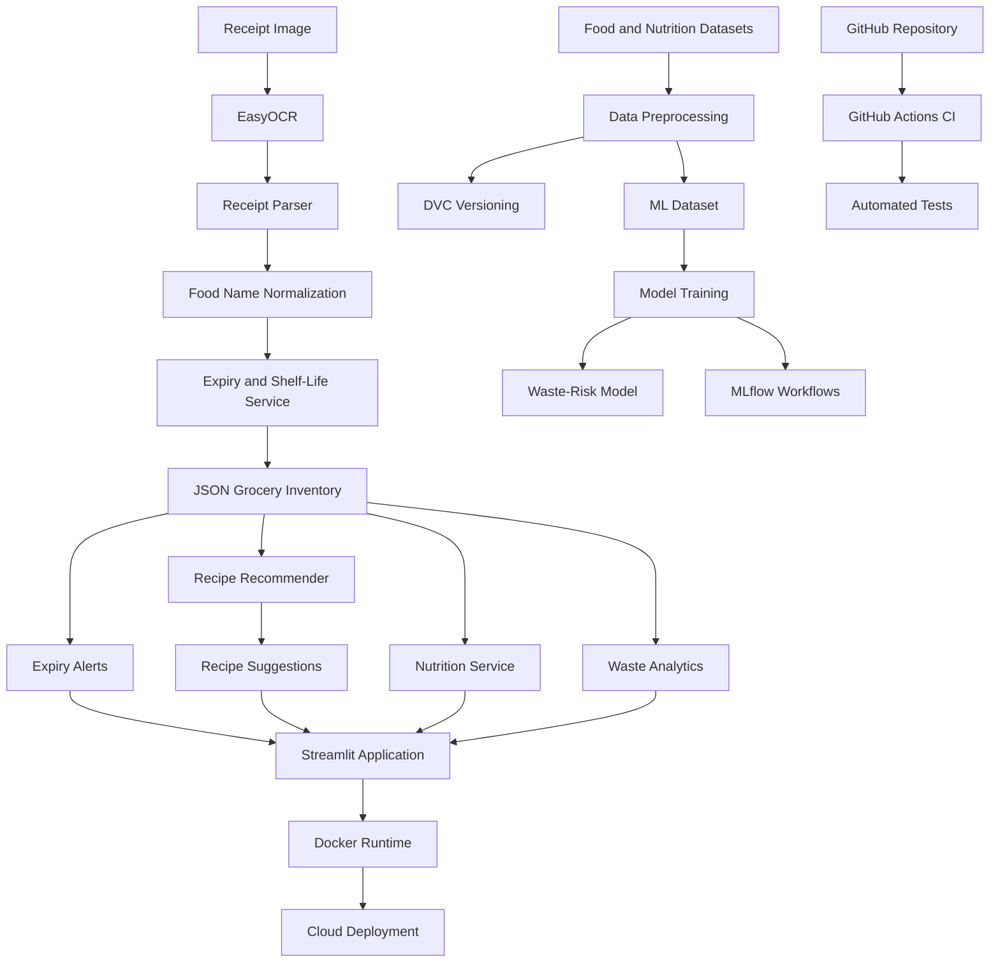

# 🥦 Smart Grocery Rescue System — MLOps-Based Food Waste Reduction

An intelligent grocery management application that helps users reduce food waste through receipt OCR, expiry-date tracking, nutrition estimation, and expiry-aware recipe recommendations. The project integrates machine learning and MLOps tools to support model development, dataset versioning, testing, and containerization.


## 📌 Project Overview

Food waste is a major challenge for households. Groceries are often discarded because users forget their expiry dates or struggle to decide what to cook with the ingredients they already have.

The **Smart Grocery Rescue System** addresses this problem by providing a centralized application for grocery inventory management, receipt processing, expiry monitoring, and recipe recommendations.

The system combines OCR, machine learning, data processing, and MLOps practices in a modular Python application.

### 🎯 Objectives

- Automate grocery item extraction from uploaded receipts.
- Maintain a digital inventory of purchased groceries.
- Estimate expiry dates using food-specific shelf-life information.
- Alert users about groceries approaching expiry.
- Recommend recipes based on available ingredients and urgency.
- Provide approximate calorie information for supported food items.
- Analyze grocery usage and waste-related information.
- Apply MLOps practices for data versioning, experiment tracking, testing, and containerization.

## ✨ Key Features

### 1. 🧾 Receipt Scanning and OCR

- Upload receipt images for text extraction.
- Use EasyOCR to recognize receipt text.
- Parse recognized text into grocery items.
- Normalize product names for shelf-life lookup.
- Generate receipt hashes to help detect duplicate uploads.

### 2. 📦 Grocery Inventory Management

- Store grocery records in JSON files.
- Track purchase dates, estimated expiry dates, storage types, and item status.
- Update items as Available, Partially Used, Fully Used, or Discarded.
- Maintain inventory information across application sessions.

### 3. ⏰ Expiry Monitoring

- Calculate estimated expiry dates from purchase dates and shelf-life information.
- Highlight groceries approaching expiry.
- Identify items that should be prioritized for consumption.
- Support expiry-aware inventory management.

### 4. 🍲 Expiry-Aware Recipe Recommendations

- Recommend recipes using available grocery ingredients.
- Calculate ingredient matches and missing ingredients.
- Prioritize recipes based on ingredient availability and expiry urgency.
- Display recipe match percentages and ingredient information.

### 5. 🥗 Nutrition and Calorie Estimation

- Look up supported grocery items in the processed nutrition dataset.
- Provide approximate calorie estimates for supported ingredients.
- Use fallback nutrition values where configured.

*Nutrition estimates are approximate and are not a substitute for verified dietary information.*

### 6. 📊 Waste Analytics and History

- Present grocery usage and waste-related information through the analytics interface.
- Support inventory history and status-based analysis.
- Use application inventory data to help users understand grocery consumption patterns.

### 7. 🤖 Machine Learning for Waste-Risk Prediction

- Prepare a structured dataset for grocery waste-risk classification.
- Train and compare Logistic Regression, Random Forest, and Gradient Boosting models.
- Save the selected model for subsequent use.
- Record model evaluation results.

**Recorded development result:** Logistic Regression achieved 95.25% accuracy on the project's evaluation split. This is a development result, not a guarantee of real-world prediction performance.

### 8. ⚙️ MLOps and Deployment

- **DVC:** Version and manage datasets separately from ordinary Git files.
- **MLflow:** Support experiment tracking workflows through the project's MLflow scripts.
- **GitHub Actions:** Automate test execution through CI workflows.
- **Docker:** Package the application and its runtime dependencies into a container.
- **pytest:** Validate key application components through automated tests.
- **DagsHub:** Host the Git repository and DVC remote.

## 🏗️ System Architecture



## 🛠️ Technology Stack

| Category             | Technologies                |
| -------------------- | --------------------------- |
| Programming language | Python                      |
| User interface       | Streamlit                   |
| OCR                  | EasyOCR, Pillow             |
| Data processing      | Pandas, NumPy               |
| Machine learning     | Scikit-learn                |
| Model serialization  | Joblib                      |
| Experiment tracking  | MLflow                      |
| Data versioning      | DVC                         |
| Remote data storage  | DagsHub                     |
| Testing              | pytest                      |
| Containerization     | Docker                      |
| CI/CD                | GitHub Actions              |
| Application storage  | JSON files and CSV datasets |
| Version control      | Git and GitHub              |

## 📂 Project Structure

```text
smart-grocery-rescue-mlops/
│
├── .github/
│   └── workflows/
│       └── ci.yml
│
├── .dvc/
│   └── config
│
├── data/
│   ├── app/
│   │   ├── grocery_inventory.json
│   │   └── recipe_feedback.json
│   ├── ml/
│   │   └── waste_risk_dataset.csv.dvc
│   ├── processed/
│   │   ├── nutrition_processed.csv
│   │   ├── recipes_processed.csv
│   │   └── shelf_life_processed.csv
│   └── raw/
│
├── models/
│   └── waste_risk_model.pkl
│
├── results/
│
├── src/
│   ├── analytics/
│   │   └── waste_analytics.py
│   ├── app/
│   │   └── app.py
│   ├── expiry/
│   │   └── shelf_life.py
│   ├── feedback/
│   │   └── feedback_manager.py
│   ├── models/
│   │   ├── train_model.py
│   │   ├── train_mlflow.py
│   │   └── test_model.py
│   ├── nutrition/
│   │   └── nutrition_service.py
│   ├── ocr/
│   │   ├── receipt_ocr.py
│   │   └── receipt_parser.py
│   ├── preprocessing/
│   └── recommendation/
│       └── recipe_recommender.py
│
├── tests/
│   ├── test_expiry.py
│   ├── test_feedback.py
│   ├── test_nutrition.py
│   ├── test_parser.py
│   └── test_recommender.py
│
├── .dockerignore
├── .gitignore
├── Dockerfile
├── dvc.yaml
├── requirements.txt
└── README.md
```

*Note: Some generated datasets and model artifacts may be managed locally or through DVC rather than stored directly in Git. The structure above summarizes the main project components.*

## 🚀 Getting Started

### Prerequisites

Install the following tools:

- Python 3.11
- Git
- Docker Desktop (for containerized execution)
- DVC (for downloading versioned datasets)

### Step 1: Clone the Repository

```bash
git clone https://github.com/Meenarekha/smart-grocery-rescue-mlops.git
cd smart-grocery-rescue-mlops
```

### Step 2: Create a Virtual Environment

**Windows PowerShell**

```powershell
py -3.11 -m venv grocery_rescue
.\grocery_rescue\Scripts\Activate.ps1
```

If PowerShell blocks activation, run:

```powershell
Set-ExecutionPolicy -Scope Process -ExecutionPolicy Bypass
.\grocery_rescue\Scripts\Activate.ps1
```

**Linux/macOS**

```bash
python3.11 -m venv grocery_rescue
source grocery_rescue/bin/activate
```

### Step 3: Install Dependencies

```bash
python -m pip install --upgrade pip
pip install -r requirements.txt
```

The project includes CPU-specific PyTorch dependencies for OCR. Dependency compatibility may vary by Python version and deployment platform.

### Step 4: Download DVC Data

```bash
dvc pull
```

If your repository uses the named DVC remote `origin`, run:

```bash
dvc pull -r origin
```

Configure access credentials for the DagsHub DVC remote if prompted. Never commit access tokens or passwords.

### Step 5: Run the Application

From the repository root:

```bash
python -m streamlit run src/app/app.py
```

Open the local URL printed in your terminal, typically:

```text
http://localhost:8501
```

## 🐳 Run with Docker

Docker provides a reproducible runtime without requiring manual activation of the Python virtual environment.

### Build the image

From the repository root:

```bash
docker build -t smart-grocery-rescue .
```

### Start the container

```bash
docker run --rm -p 8501:8501 smart-grocery-rescue
```

Open `http://localhost:8501` in your browser.

**Important:** Ensure that required processed datasets and model artifacts are available in the container. If any data files are excluded through `.dockerignore` or managed by DVC, retrieve or copy them as required before building the image.

Application changes made to JSON files inside a disposable container may not persist after the container stops. Use a mounted volume or persistent storage when required.

## ☁️ Deploy on Streamlit Community Cloud

1. Push the project to GitHub.

2. Open [Streamlit Community Cloud](https://share.streamlit.io/).

3. Connect your GitHub account and select this repository.

4. Select the `main` branch.

5. Set the application entry point to:

   ```text
   src/app/app.py
   ```

6. Configure any required secrets or credentials through the deployment platform's secrets settings.

7. Deploy the application and inspect the logs if dependency installation or data loading fails.

**Deployment note:** The repository must contain or successfully retrieve every runtime dataset needed by the app. Cloud instances may also have limited memory and storage, so OCR and PyTorch dependency installation should be tested on the target platform.

## 🧪 Run Tests

Run the automated test suite:

```bash
pytest tests/ -v
```

The test suite covers:

- Shelf-life calculations and food normalization
- Feedback handling
- Nutrition lookup and fallback behavior
- Receipt parsing
- Recipe recommendation scoring

The local development test run recorded **7 passing tests**. Run the tests again after any changes to verify the current state.

## 📈 Model Training

To train the waste-risk classification model:

```bash
python src/models/train_model.py
```

The training pipeline compares multiple Scikit-learn classifiers and saves the selected model and evaluation outputs according to the script configuration.

For MLflow-based experiment workflows, inspect and run the relevant script:

```bash
python src/models/train_mlflow.py
```

MLflow tracking requires a correctly configured tracking URI and backend. For a local tracking UI, use:

```bash
mlflow ui --port 5000
```

Then open `http://localhost:5000`.

## 🔄 MLOps Workflow

The project follows a practical MLOps-oriented workflow:

1. **Data ingestion:** Collect grocery, recipe, nutrition, and shelf-life datasets.
2. **Data preprocessing:** Clean and transform raw datasets into usable CSV files.
3. **Data versioning:** Track dataset versions with DVC and store managed data in the configured remote.
4. **Model training:** Train and evaluate waste-risk classifiers.
5. **Experiment tracking:** Use the project's MLflow workflows to record model experiments when configured.
6. **Automated testing:** Run pytest tests through the development and CI workflow.
7. **Containerization:** Package the application with Docker.
8. **Deployment:** Run the Streamlit application locally or deploy it to a compatible hosting platform.

## 🔐 Configuration and Data Management

- Keep API keys, access tokens, and credentials out of Git.
- Use environment variables or platform secrets for sensitive configuration.
- Keep large raw datasets and model artifacts out of ordinary Git commits when managed through DVC.
- Avoid committing virtual environments, cache directories, and temporary experiment outputs.
- Use persistent storage for inventory and feedback if deployed in an environment with an ephemeral filesystem.
- Review the repository's `.gitignore`, `.dockerignore`, and DVC configuration before publishing.

## 🔮 Future Enhancements

- Improve OCR accuracy for different receipt formats and currencies.
- Add barcode scanning and more robust product-name matching.
- Introduce user accounts and persistent database storage.
- Improve waste-risk predictions with more representative real-world data.
- Add automated model evaluation and model-version promotion.
- Expand CI/CD to include container build verification and deployment checks.
- Add scheduled notifications for expiring groceries.
- Enhance recipe recommendations with dietary preferences and nutritional constraints.
- Improve monitoring and logging for deployed application errors.

## 🎓 Learning Outcomes

This project demonstrates practical experience with:

- Python application development
- OCR and text processing
- Machine learning model development and evaluation
- Data preprocessing and versioning
- Experiment-tracking workflows
- Automated unit testing
- Git-based collaboration and CI
- Docker containerization
- Streamlit application deployment

## 👩‍💻 Author

**Meenarekha E**

Artificial Intelligence and Data Science | MLOps | Machine Learning | Python

- GitHub: [Meenarekha](https://github.com/Meenarekha)
- Project Repository: [Smart Grocery Rescue MLOps](https://github.com/Meenarekha/smart-grocery-rescue-mlops)
