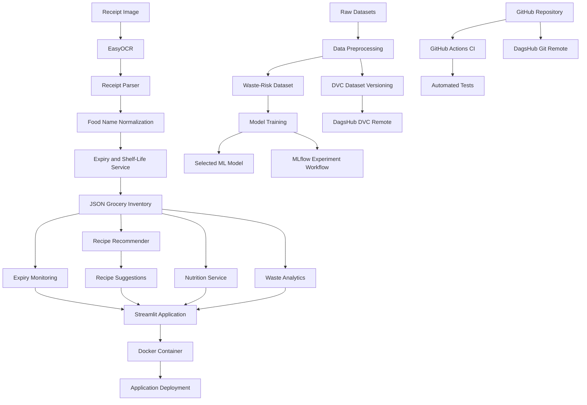

# 🥦 Smart Grocery Rescue — An End-to-End MLOps Project

**An intelligent grocery management system designed to reduce household food waste through receipt OCR, expiry tracking, nutrition estimation, recipe recommendations, and machine learning.**

[](https://www.python.org/)
[](https://streamlit.io/)
[](https://www.docker.com/)
[](https://mlflow.org/)
[](https://dvc.org/)
[](https://github.com/features/actions)

**Repository:** [GitHub](https://github.com/Meenarekha/smart-grocery-rescue-mlops) | **MLOps Platform:** [DagsHub](https://dagshub.com/Meena/smart-grocery-rescue-mlops)

---
## 🚀 Live Demo

**Try the application:** [Smart Grocery Rescue — Live App](https://smart-grocery-rescue-mlops-84guujzfxv6oktotzfdfqk.streamlit.app/)

Explore grocery inventory management, receipt scanning, expiry monitoring, nutrition estimation, and expiry-aware recipe recommendations.

## 📌 1. Project Overview

Food waste is a significant household problem. Groceries are often thrown away because people forget expiry dates, purchase duplicate items, or do not know how to use the ingredients they already have.

The **Smart Grocery Rescue System** provides an intelligent grocery management application that helps users track inventory, identify expiring food, estimate nutrition, and discover recipes based on available ingredients.

The project combines a Streamlit application with machine learning components and an MLOps workflow for dataset versioning, experiment tracking, automated testing, and containerization.

### 🎯 Objectives

- Automate grocery item extraction from receipt images.
- Maintain a digital inventory of purchased groceries.
- Estimate expiry dates using food-specific shelf-life information.
- Identify expired and soon-to-expire groceries.
- Recommend recipes using available ingredients.
- Estimate calories for supported grocery items.
- Analyze grocery usage and waste-related information.
- Build a reproducible machine learning workflow.
- Apply MLOps practices using DVC, DagsHub, MLflow, GitHub Actions, and Docker.

## ✨ 2. Key Features

### 🧾 Receipt OCR and Parsing

- Upload grocery receipt images.
- Extract text using EasyOCR.
- Parse receipt text into potential grocery items.
- Normalize product names for downstream processing.
- Generate receipt hashes to help identify duplicate uploads.

### 📦 Grocery Inventory Management

- Maintain grocery records in JSON files.
- Track purchase dates, expiry dates, storage types, and item status.
- Update items as Available, Partially Used, Fully Used, or Discarded.
- Maintain inventory and recipe feedback across application sessions, subject to the storage environment.

### ⏰ Expiry Monitoring

- Estimate expiry dates from purchase dates and shelf-life information.
- Identify expired groceries based on their expiry dates.
- Highlight groceries that need attention.
- Help users prioritize food consumption.

Expiry dates are estimates based on the configured shelf-life information and may not reflect actual food safety.

### 🍲 Expiry-Aware Recipe Recommendations

- Recommend recipes using available ingredients.
- Calculate ingredient matches.
- Identify missing ingredients.
- Consider ingredient availability and expiry urgency when ranking recipes.
- Display recipe suggestions through the Streamlit interface.

### 🥗 Nutrition Estimation

- Look up supported grocery items in the processed nutrition dataset.
- Display approximate calorie information.
- Use configured fallback values for certain unsupported items.

Nutrition values are estimates and may vary by brand, serving size, and preparation method.

### 📊 Waste Analytics Dashboard

- Display inventory and grocery status information.
- Visualize grocery usage and waste-related metrics.
- Review inventory history.
- Help users understand their grocery consumption patterns.

### 🤖 Machine Learning for Waste-Risk Prediction

The project includes a supervised machine learning pipeline that prepares a structured dataset for grocery waste-risk classification.

Models evaluated during development:

- Logistic Regression
- Random Forest
- Gradient Boosting

The training workflow compares model performance and saves the selected model and evaluation outputs according to the training script.

**Recorded development result:** Logistic Regression achieved 95.25% accuracy on the evaluation split. This is a development result and does not establish performance on unseen real-world grocery data.

### ⚙️ MLOps and Deployment

- DVC for dataset versioning.
- DagsHub for Git repository hosting and remote data storage.
- MLflow for experiment-tracking workflows.
- GitHub Actions for automated testing.
- Docker for containerized execution.
- pytest for automated tests.
- Streamlit for the interactive user interface.

---

## 🏗️ 3. System Architecture



### Workflow Summary

1. Receipt images are processed by the OCR and receipt-parsing modules.
2. Extracted grocery items are normalized and added to the inventory.
3. Shelf-life data is used to estimate expiry dates.
4. Inventory information supports expiry monitoring, recipe recommendations, nutrition lookups, and analytics.
5. Separate preprocessing and training scripts support the waste-risk classification pipeline.
6. DVC manages versioned datasets, while DagsHub stores the configured remote data.
7. MLflow supports experiment tracking through the project's training workflows.
8. GitHub Actions runs automated tests.
9. Docker packages the application and its dependencies for execution.

---

## 🛠️ 4. Technology Stack

| Category | Technology |
|---|---|
| Programming language | Python 3.11 |
| Frontend and dashboard | Streamlit |
| OCR | EasyOCR |
| Image processing | Pillow |
| Data processing | Pandas, NumPy |
| Machine learning | Scikit-learn |
| Model serialization | Joblib |
| Experiment tracking | MLflow |
| Dataset versioning | DVC |
| MLOps platform | DagsHub |
| Automated testing | pytest |
| CI/CD | GitHub Actions |
| Containerization | Docker |
| Application storage | JSON and CSV files |
| Version control | Git and GitHub |

---

## 📂 5. Repository Structure

```text
smart-grocery-rescue-mlops/
│
├── .github/
│   └── workflows/
│       └── ci.yml
│
├── .dvc/
│   └── config
│
├── data/
│   ├── app/
│   │   ├── grocery_inventory.json
│   │   └── recipe_feedback.json
│   ├── ml/
│   │   ├── .gitignore
│   │   └── waste_risk_dataset.csv.dvc
│   ├── raw/
│   │   └── raw.dvc
│   ├── processed/
│   │   └── processed.dvc
│   └── processed.dvc
│
├── models/
│   └── waste_risk_model.pkl
│
├── results/
│
├── src/
│   ├── analytics/
│   │   └── waste_analytics.py
│   ├── app/
│   │   └── app.py
│   ├── expiry/
│   │   └── shelf_life.py
│   ├── feedback/
│   │   └── feedback_manager.py
│   ├── models/
│   │   ├── train_model.py
│   │   ├── train_mlflow.py
│   │   ├── train_mlflow_backup.py
│   │   └── test_model.py
│   ├── nutrition/
│   │   └── nutrition_service.py
│   ├── ocr/
│   │   ├── receipt_ocr.py
│   │   └── receipt_parser.py
│   ├── preprocessing/
│   │   ├── preprocess_data.py
│   │   ├── preprocess_nutrition.py
│   │   ├── preprocess_shelf_life.py
│   │   └── create_ml_dataset.py
│   └── recommendation/
│       └── recipe_recommender.py
│
├── tests/
│   ├── test_expiry.py
│   ├── test_feedback.py
│   ├── test_nutrition.py
│   ├── test_parser.py
│   └── test_recommender.py
│
├── .dockerignore
├── .gitignore
├── Dockerfile
├── requirements.txt
└── README.md
```

*Note: This is a representative structure. DVC metadata files track data stored separately from Git. Actual raw datasets, processed files, and model artifacts may be available locally or through the configured remote rather than committed to Git.*

---

## 🚀 6. Getting Started

### Prerequisites

Install:

- Python 3.11
- Git
- Docker Desktop, if using Docker
- DVC
- Access to the configured DagsHub DVC remote when downloading remote datasets

### Step 1: Clone the Repository

```bash
git clone https://github.com/Meenarekha/smart-grocery-rescue-mlops.git
cd smart-grocery-rescue-mlops
```

### Step 2: Create and Activate a Virtual Environment

**Windows PowerShell**

```powershell
py -3.11 -m venv grocery_rescue
Set-ExecutionPolicy -Scope Process -ExecutionPolicy Bypass
.\grocery_rescue\Scripts\Activate.ps1
```

**Linux/macOS**

```bash
python3.11 -m venv grocery_rescue
source grocery_rescue/bin/activate
```

### Step 3: Install Dependencies

```bash
python -m pip install --upgrade pip
pip install -r requirements.txt
```

The project uses CPU-specific PyTorch dependencies for OCR. Installation requirements can vary by operating system and deployment platform.

### Step 4: Retrieve Versioned Datasets

Install DVC if it is not already available:

```bash
pip install "dvc[http]"
```

Inspect the configured remote:

```bash
dvc remote list
```

Pull the versioned datasets:

```bash
dvc pull -r origin
```

Configure DagsHub credentials if the remote requires authentication. Do not commit access tokens or passwords.

### Step 5: Run the Application

Run from the repository root:

```bash
python -m streamlit run src/app/app.py
```

Open the local URL shown in the terminal, typically:

http://localhost:8501

---

## 🐳 7. Docker Deployment

Docker packages the application and its runtime dependencies into a container.

### Build the Docker Image

Run from the repository root:

```bash
docker build -t smart-grocery-rescue .
```

### Start the Container

```bash
docker run --rm -p 8501:8501 smart-grocery-rescue
```

Open:

http://localhost:8501

### Important Deployment Considerations

- Make sure the processed datasets and required model artifacts are present before building or starting the container.
- If datasets are managed by DVC, retrieve them before the build unless your container workflow explicitly downloads them.
- The container must include all runtime dependencies used by the Streamlit application.
- A disposable container may lose changes to its local JSON inventory when it stops. Use persistent storage or a mounted volume when persistence is required.
- Do not bake secrets into the Docker image.

---

## ☁️ 8. DagsHub Integration

[DagsHub](https://dagshub.com/) is the central MLOps platform used by this project for Git repository hosting and DVC remote storage.

### Why DagsHub?

Machine learning projects often involve datasets that are too large or change too frequently to manage efficiently using ordinary Git commits alone.

DagsHub and DVC separate source-code version control from dataset storage, making it easier to retrieve the data associated with a particular version of the project.

### How DagsHub Is Used

**1. Git Repository Hosting**

The project source code and Git commit history are synchronized with the DagsHub repository.

Repository: [Smart Grocery Rescue on DagsHub](https://dagshub.com/Meena/smart-grocery-rescue-mlops)

**2. DVC Remote Storage**

DVC metadata files describe the versioned datasets. The actual dataset contents are stored in the configured DVC remote.

Configured remote endpoint:

```text
https://dagshub.com/Meena/smart-grocery-rescue-mlops.dvc
```

**3. Dataset Versioning**

DVC tracks dataset versions independently of ordinary Git files. This helps reproduce preprocessing and training workflows using the corresponding data versions.

**4. Experiment-Tracking Workflows**

The project includes MLflow training scripts. Remote MLflow tracking through DagsHub requires the tracking server and credentials to be configured separately.

### Useful DVC Commands

List configured remotes:

```bash
dvc remote list
```

Check cache and remote synchronization:

```bash
dvc status -c
```

Download versioned datasets:

```bash
dvc pull -r origin
```

Upload updated datasets:

```bash
dvc push -r origin
```

### Git Remotes and DVC Remotes

The project uses two Git remotes:

| Remote | Purpose |
|---|---|
| `origin` | GitHub repository |
| `dagshub` | DagsHub Git repository |

The DVC remote is separately configured with the name `origin` and points to the DagsHub `.dvc` endpoint.

Consequently:

```bash
git push origin main
```

pushes Git commits to GitHub, while:

```bash
git push dagshub main
```

pushes Git commits to DagsHub.

By contrast:

```bash
dvc push -r origin
```

uploads tracked dataset objects to the configured DVC remote.

These operations are separate: pushing Git commits does not automatically upload missing DVC objects.

---

## 📊 9. MLflow Experiment Tracking

[MLflow](https://mlflow.org/) supports tracking machine learning experiments, including parameters, evaluation metrics, and artifacts.

The project includes an MLflow-oriented training workflow in `src/models/train_mlflow.py`.

### Run the Training Workflow

```bash
python src/models/train_mlflow.py
```

Review the script's configuration before execution to ensure the required dataset paths and tracking settings are correct.

### Launch the Local MLflow UI

```bash
mlflow ui --port 5000
```

Open:

http://localhost:5000

A local tracking server provides a convenient way to inspect experiments recorded in the configured local backend.

**Note:** Remote experiment tracking is a separate configuration step. Do not assume that experiments are visible in DagsHub merely because the Git repository and DVC remote are hosted there.

---

## 🔄 10. MLOps Pipeline

The project follows a practical MLOps workflow.

| Stage | Tool or Component | Purpose |
|---|---|---|
| Data ingestion | Python scripts | Load source datasets |
| Data preprocessing | Pandas | Clean and transform datasets |
| Dataset versioning | DVC | Track dataset versions |
| Remote data storage | DagsHub | Store DVC-managed data |
| Model training | Scikit-learn | Train waste-risk classifiers |
| Experiment tracking | MLflow | Record experiments when configured |
| Source control | Git and GitHub | Manage application versions |
| Continuous integration | GitHub Actions | Run automated checks |
| Testing | pytest | Validate application components |
| Containerization | Docker | Package the runtime |
| Application interface | Streamlit | Provide interactive access |

### GitHub Actions CI

The project's GitHub Actions workflow is configured to run when changes are pushed to `main` or when a pull request targets `main`.

The workflow installs dependencies, configures access to the DVC remote, retrieves versioned data, and runs the automated tests.

Required DagsHub credentials should be stored in GitHub Actions repository secrets rather than hard-coded into the workflow.

---

## 🧪 11. Testing

Run the automated test suite:

```bash
pytest tests/ -v
```

The tests cover:

- Shelf-life calculations
- Feedback management
- Nutrition lookup and fallback behavior
- Receipt parsing
- Recipe recommendation scoring

**Recorded local test result:** 7 tests passed in 1.99 seconds during development.

This result reflects that particular test run. Run the tests again after modifying the application or its dependencies.

---

## 🤖 12. Model Training

The project includes scripts for dataset preparation and model training.

### Prepare the Waste-Risk Dataset

Run the preprocessing scripts in the required order, ensuring their input datasets are available:

```bash
python src/preprocessing/preprocess_data.py
python src/preprocessing/preprocess_nutrition.py
python src/preprocessing/preprocess_shelf_life.py
python src/preprocessing/create_ml_dataset.py
```

### Train the Model

```bash
python src/models/train_model.py
```

The training script evaluates the configured classifiers and saves the selected model and results according to its implementation.

### Run the MLflow Training Workflow

```bash
python src/models/train_mlflow.py
```

Review the script's input paths, tracking configuration, and output destinations before running it.

---

## 🔐 13. Security and Data Management

- Never commit DagsHub tokens, passwords, or other credentials.
- Store secrets in environment variables or the relevant platform's secret manager.
- Keep virtual environments, temporary files, and unnecessary generated artifacts out of Git.
- Use DVC for datasets that should not be committed as ordinary Git files.
- Verify `.gitignore` and `.dockerignore` before pushing or building.
- Use persistent storage for inventory and feedback in environments where the local filesystem is ephemeral.
- Restrict access to private datasets and credentials.

---

## 🚀 14. Future Enhancements

- Improve OCR accuracy for different receipt formats.
- Add barcode scanning and stronger product-name normalization.
- Add database-backed inventory persistence.
- Improve waste-risk model evaluation with larger, representative datasets.
- Introduce model versioning and automated model evaluation.
- Extend CI to include Docker build validation.
- Add scheduled notifications for groceries approaching expiry.
- Expand nutrition and recipe coverage.
- Add deployment health checks, monitoring, and structured logging.
- Configure and validate remote MLflow tracking.

---

## 🎓 15. Learning Outcomes

This project demonstrates practical experience with:

- Python application development
- OCR and text processing
- Machine learning classification
- Data preprocessing and dataset management
- DVC-based data versioning
- DagsHub integration
- MLflow experiment-tracking workflows
- Automated testing with pytest
- Git-based version control
- GitHub Actions CI
- Docker containerization
- Streamlit deployment

---

## 👩‍💻 16. Author

**Meena E**

Artificial Intelligence and Data Science | Machine Learning | MLOps

- **GitHub:** [Meenarekha](https://github.com/Meenarekha)
- **Project Repository:** [Smart Grocery Rescue MLOps](https://github.com/Meenarekha/smart-grocery-rescue-mlops)
- **DagsHub:** [Smart Grocery Rescue](https://dagshub.com/Meena/smart-grocery-rescue-mlops)

---
